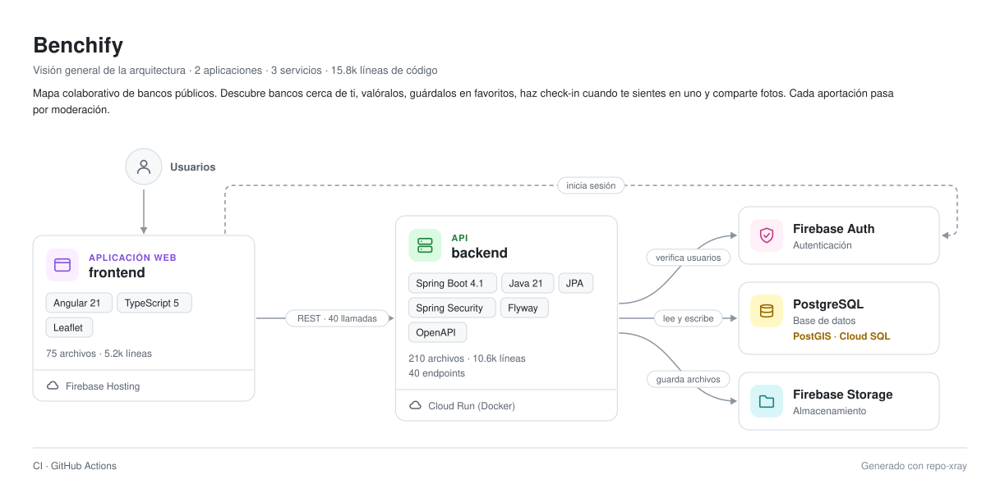
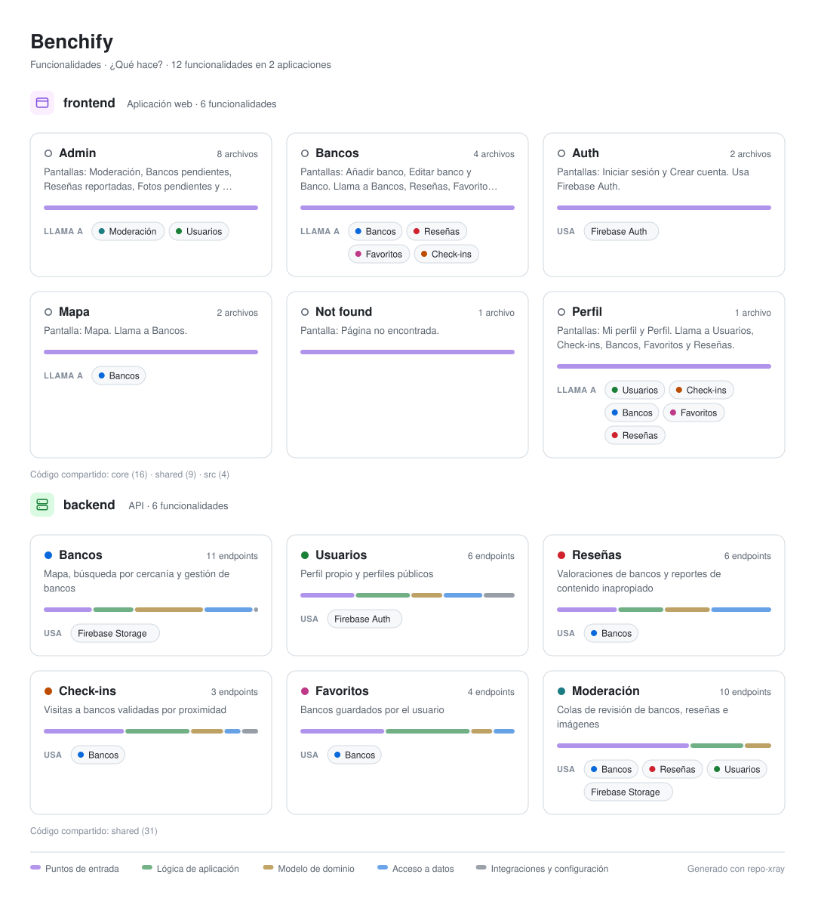
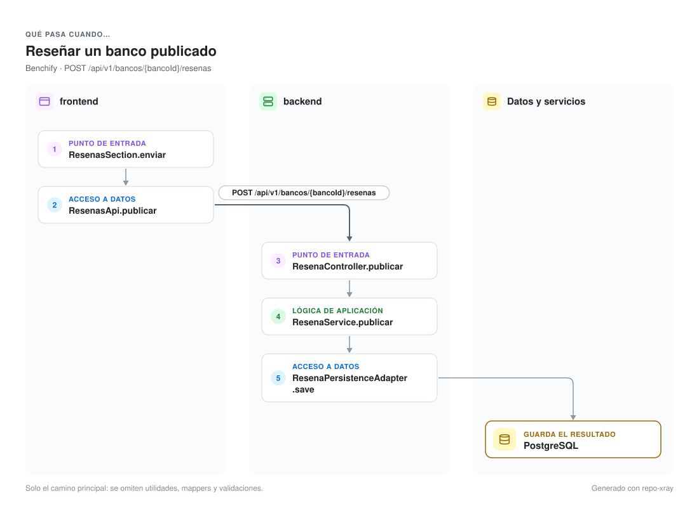
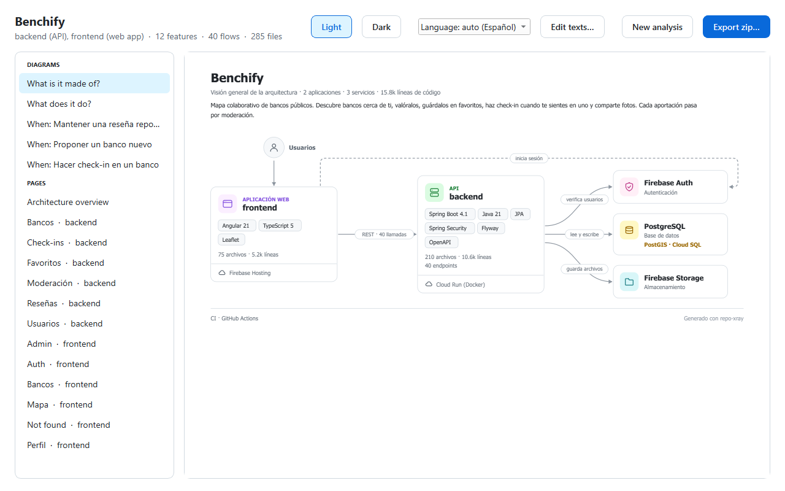
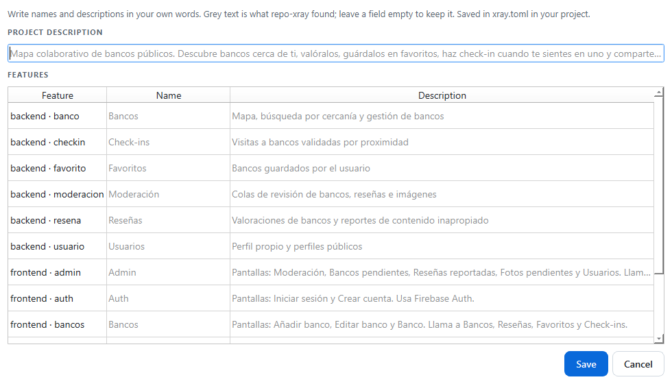

# repo-xray

**Documentación de arquitectura generada a partir del código.** Le indicas un proyecto a repo-xray y obtienes diagramas y páginas claros y cuidados que lo explican en tres niveles: de qué está hecho, qué hace y qué pasa cuando alguien lo usa. Todo funciona en tu ordenador, gratis, sin IA y sin cuentas.

[English](README.md) · Español

<picture>
  <source media="(prefers-color-scheme: dark)" srcset="docs/images/example-overview-dark.svg">
  
</picture>

<sub>Todas las imágenes de este README las ha generado repo-xray a partir del código de [Benchify](https://github.com/Maanuu77/Benchify), un proyecto full-stack con una API en Spring Boot y un frontend en Angular.</sub>

## Por qué

Un único diagrama de una aplicación real es un muro de cajas. repo-xray explica un proyecto como lo haría una persona, una pregunta cada vez, y nunca muestra más de unos nueve elementos a la vez:

| Nivel | Pregunta | Se obtiene de |
| --- | --- | --- |
| 1 · Visión general | ¿De qué está hecho? | Manifiestos de build, dependencias, imports, `compose.yaml`, `firebase.json`, archivos de nube y de CI |
| 2 · Funcionalidades | ¿Qué hace? | Carpetas de funcionalidad o cortes verticales, capas, tags de OpenAPI, títulos de rutas |
| 3 · Flujos | ¿Qué pasa cuando…? | Llamadas seguidas desde la pantalla, pasando por la petición HTTP, hasta la base de datos |

### ¿Qué hace?

Cada funcionalidad tiene una tarjeta con las capas que toca. Las del frontend muestran, con los colores de las del backend, a cuáles llaman, así la relación entre ambos lados se entiende sin una maraña de líneas.

<picture>
  <source media="(prefers-color-scheme: dark)" srcset="docs/images/example-features-dark.svg">
  
</picture>

### ¿Qué pasa cuando…?

Una petición seguida desde el botón que pulsa el usuario hasta la tabla donde se guarda.

<picture>
  <source media="(prefers-color-scheme: dark)" srcset="docs/images/example-flow-dark.svg">
  
</picture>

## Cómo empezar

### La aplicación (Windows)

1. Descarga `repo-xray.exe` desde la página de Releases de este repositorio. No hace falta instalar nada más.
2. Ábrelo con doble clic. Windows puede avisar de que la aplicación no está firmada: pulsa **Más información** y después **Ejecutar de todas formas**.
3. Arrastra la carpeta de tu proyecto a la ventana o pulsa **Choose project folder…**.
4. Revisa los diagramas y las páginas y pulsa **Export zip…**.

<p align="center">
  
</p>

El zip contiene una carpeta `architecture` para el `docs/` de tu repositorio, un `README-snippet.md` para pegar en tu README y una guía `HOW-TO-USE.md`. Los diagramas van en SVG, en versión clara y oscura (GitHub elige la que corresponde al tema de cada lector), y además en PNG para presentaciones y publicaciones.

### Desde el código

Necesita Python 3.11 o superior.

```bash
python -m venv .venv
.venv/Scripts/python -m pip install -r requirements.txt     # en macOS o Linux: .venv/bin/python
.venv/Scripts/python -m repo_xray                           # abre la aplicación
.venv/Scripts/python -m repo_xray ruta/al/proyecto --export docs.zip
```

## Tus palabras, en tu idioma

Los nombres y las descripciones salen del propio código: `@Tag` de OpenAPI, Javadoc y JSDoc, títulos de rutas y el primer párrafo del README del proyecto. Donde el código no dice nada, repo-xray escribe una frase construida solo con lo que ha encontrado, por ejemplo *"Pantallas: Iniciar sesión y Crear cuenta. Usa Firebase Auth."*

Los documentos siguen el idioma de los comentarios del código, inglés o español, así nunca se mezclan. En la aplicación, **Edit texts…** permite renombrar funcionalidades y reescribir descripciones, y el selector de idioma cambia entre automático, inglés y español. Lo que elijas se guarda en `xray.toml` dentro del proyecto analizado, así el siguiente análisis lo mantiene:

```toml
language = "es"
description = "Mapa colaborativo de bancos públicos."

[features."frontend/auth"]
name = "Acceso"
description = "Iniciar sesión o crear una cuenta con Firebase."
```

<p align="center">
  
</p>

## Qué entiende

| | |
| --- | --- |
| Lenguajes | Python (`ast`), Java y TypeScript/JavaScript (tree-sitter) |
| Backends | Endpoints de Spring Boot (`@GetMapping`, `@PostMapping`… con prefijos de clase), FastAPI, Flask, Django, Express, NestJS (detectados por sus dependencias) |
| Frontends | Angular (componentes, `inject()`, inyección por constructor, rutas), React (componentes, hooks, rutas), llamadas HTTP con `HttpClient`, `fetch` y `axios` |
| Servicios | PostgreSQL y PostGIS, MySQL, MongoDB, Redis, Kafka, RabbitMQ, Firebase Auth, Storage y Firestore, Supabase, Amazon S3, Stripe… |
| Despliegue y CI | Docker, Cloud Run, Firebase Hosting, Vercel, Netlify, Fly.io, Render, Heroku, App Engine, GitHub Actions, GitLab CI |

Añadir una tecnología es una línea en [`catalog.py`](repo_xray/analysis/catalog.py).

## Cómo funciona

```
escaneo → parseo → stack · grafo de llamadas · enlaces HTTP → funcionalidades · flujos → textos → SVG, Markdown, PNG → zip
```

- **El parseo** nunca ejecuta el código analizado: Python se lee con `ast` y Java y TypeScript con tree-sitter, hacia un modelo común a todos los lenguajes.
- **Las llamadas se resuelven** a través de los tipos de los campos, los imports, las interfaces y sus implementaciones, así `resenas.publicar(...)` en un controlador llega a `ResenaService.publicar` y de ahí al adaptador de persistencia.
- **Las llamadas del frontend se enlazan con los endpoints** comparando las rutas desde el final, porque la URL base del frontend no suele conocerse: `{this.url}/bancos/{id}/resenas` encaja con `/api/v1/bancos/{bancoId}/resenas`.
- **Los diagramas** son SVG maquetados a mano con solo funciones de SVG Tiny, así los navegadores, GitHub y Qt los dibujan igual. El texto se mide para que nunca se salga de su caja.

El porqué de cada decisión está recogido en [Architecture Decision Records](docs/adr/) (en inglés): análisis estático con `ast` y tree-sitter, tres niveles exportados en un zip, una aplicación de escritorio para principiantes, un ejecutable de un solo archivo y [por qué no hay IA](docs/adr/0011-no-ai.md).

## Limitaciones

- Lee el código, no lo ejecuta. No sigue llamadas sobre variables locales ni sobre valores devueltos por otras llamadas, así que un flujo muestra el camino principal, no todas las ramas.
- Los flujos empiezan en endpoints HTTP. Los proyectos sin ellos tienen solo los niveles 1 y 2.
- Los nombres se quedan en el idioma del código salvo que los edites; no se traduce nada automáticamente.
- El ejecutable es para Windows. En macOS y Linux se usa desde el código.

## Desarrollo

```bash
.venv/Scripts/python -m pip install -r requirements-dev.txt
.venv/Scripts/python -m pytest                         # unas 200 pruebas, incluida la aplicación
.venv/Scripts/python -m pip install -r requirements-build.txt
.venv/Scripts/python packaging/build.py                # dist/repo-xray.exe
```

El código está en el paquete `repo_xray`: `parsers/` (un módulo por lenguaje), `analysis/` (stack, capas, funcionalidades, llamadas, enlaces, flujos, textos), `render/` (los tres diagramas), `export/` (Markdown, PNG y zip) y `app/` (la aplicación de escritorio). El plan y su historia están en [docs/ROADMAP.md](docs/ROADMAP.md) y los cambios de cada versión en [CHANGELOG.md](CHANGELOG.md).

## Licencia

[MIT](LICENSE) © 2026 Manuel Martínez
