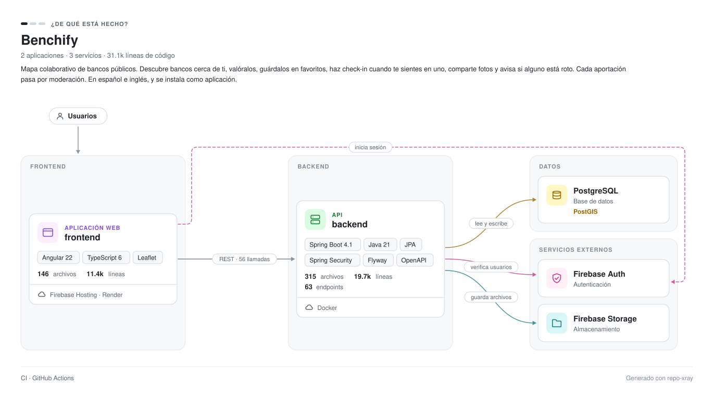
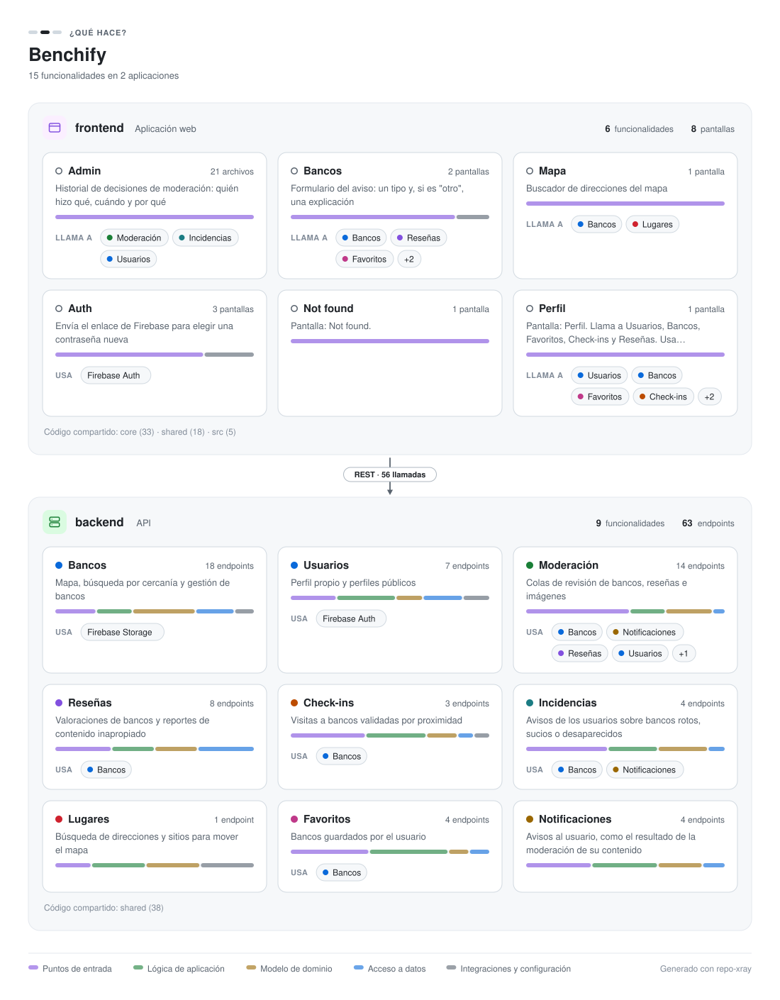
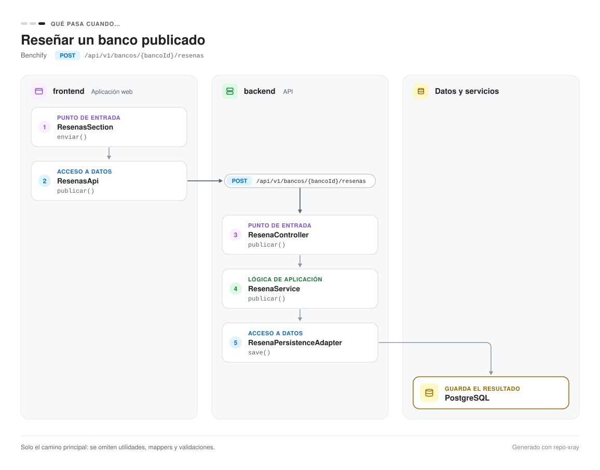
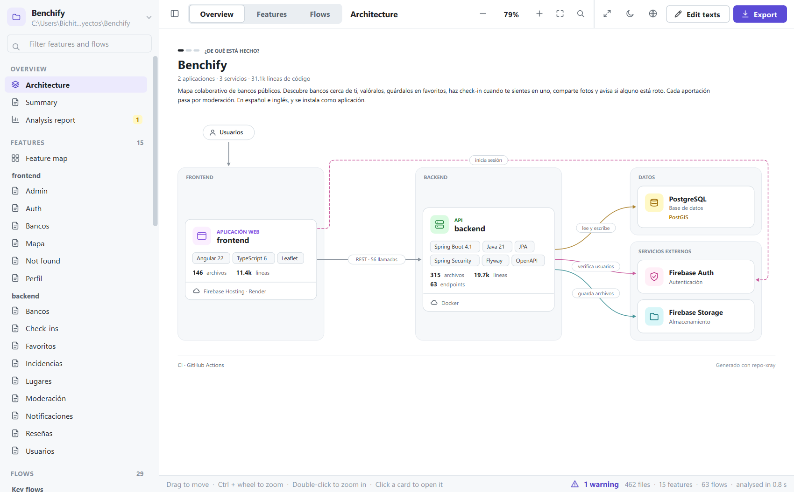
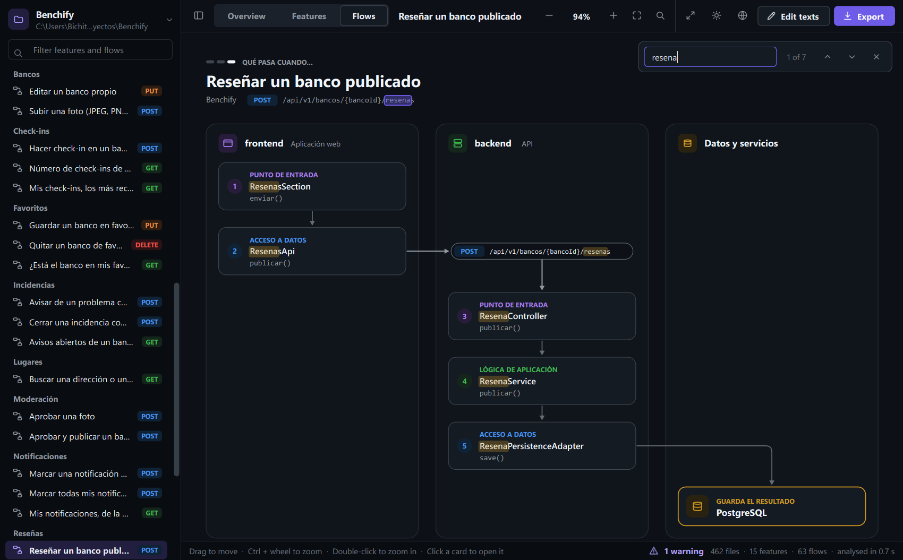
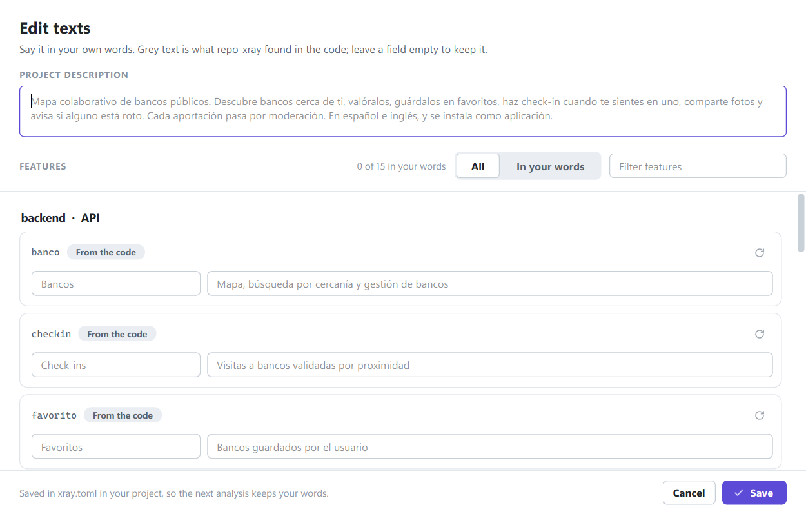

# repo-xray

**Architecture documentation generated from source code.** Point repo-xray at a project and get clear, good-looking diagrams and pages that explain it in three levels: what it is made of, what it does, and what happens when someone uses it. Everything runs on your computer, for free, with no AI and no account.

English · [Español](README.es.md)

<picture>
  <source media="(prefers-color-scheme: dark)" srcset="docs/images/example-overview-dark.svg">
  
</picture>

<sub>Every image in this README was generated by repo-xray from the code of [Benchify](https://github.com/Maanuu77/Benchify), a full-stack project with a Spring Boot API and an Angular frontend. Benchify is written in Spanish, so its documents are in Spanish.</sub>

## Why

A single diagram of a real application is a wall of boxes. repo-xray explains a project the way a person would, one question at a time, and never shows more than about nine elements at once:

| Level | Question | Built from |
| --- | --- | --- |
| 1 · Overview | What is it made of? | Build manifests, dependencies, imports, `compose.yaml`, `firebase.json`, cloud and CI files |
| 2 · Features | What does it do? | Feature folders or vertical slices, layers, packages, OpenAPI tags, route titles |
| 3 · Flows | What happens when…? | Calls followed from the screen, through the HTTP request, down to the database |

Every diagram says which of the three questions it answers, groups what belongs together in a zone (a tier, an app, a lane) and keeps its labels in the gaps between zones, never on top of a card.

### What does it do?

Each app is a zone and each feature a card with the layers it touches. Frontend features show, in the backend features' colours, which ones they call, and one connector between the zones says how many requests cross from the screens to the API.

<picture>
  <source media="(prefers-color-scheme: dark)" srcset="docs/images/example-features-dark.svg">
  
</picture>

### What happens when…?

A request followed from the button the user presses to the table where it ends up. The HTTP request is drawn where it crosses from one app to the next, with its method and its route, and the last card says whether the request reads, stores or deletes.

<picture>
  <source media="(prefers-color-scheme: dark)" srcset="docs/images/example-flow-dark.svg">
  
</picture>

## Getting started

### The app (Windows)

1. Download `repo-xray.exe` from the Releases page of this repository. Nothing else needs to be installed.
2. Double-click it. Windows may warn that the app is not signed: click **More info**, then **Run anyway**.
3. Drop your project's folder anywhere on the window, or click **Choose folder…**.
4. Explore the diagrams and pages, then click **Export**.

<p align="center">
  
</p>

The zip contains an `architecture` folder for your repository's `docs/`, a `README-snippet.md` to paste into your README, and a `HOW-TO-USE.md` guide. Diagrams come as SVG in light and dark versions, which GitHub picks according to each reader's theme, plus PNG copies for slides and posts. The **Export** menu also saves the diagram on screen as SVG or PNG, or copies it to the clipboard.

### Finding your way around

- **Three levels, one click apart.** The sidebar lists every document under Overview, Features and Flows; the tabs at the top (or `Ctrl+1`, `Ctrl+2`, `Ctrl+3`) jump to each level, and a filter narrows a long list by name, description or route.
- **Diagrams you can move in.** Drag to move, `Ctrl` + wheel to zoom, double-click to zoom in, `0` to fit. `Ctrl+F` finds text inside the diagram.
- **Cards that lead somewhere.** Click a feature's card to open its page, an app to see its features, a step of a flow to reach the feature it belongs to. Pages draw their diagrams in place and their links navigate.
- **Light, dark or the system's.** One switch changes the whole window and the diagram on show.
- **An honest analysis.** While it runs you see the real stage and how many files have been read, and you can cancel it. The **Analysis report** says what was read, the evidence behind each service and what could not be resolved: files that do not parse, requests without an endpoint, flows that stop at the controller.

<p align="center">
  
</p>

| Keys | What they do |
| --- | --- |
| `Ctrl+O` · `F5` | Open another folder · analyse again |
| `Ctrl+1` `Ctrl+2` `Ctrl+3` | Overview · Features · Flows |
| `Ctrl+PgDn` · `Ctrl+PgUp` | Next · previous document |
| `Ctrl+K` · `Ctrl+F` | Filter the sidebar · find in the diagram |
| `+` `-` `0` `1` · arrows | Zoom in, zoom out, fit, 100 % · move |
| `Ctrl+T` · `Ctrl+E` · `Ctrl+Shift+C` | Edit texts · export the zip · copy the diagram |
| `Ctrl+B` · `Ctrl+D` · `F11` | Sidebar · light or dark · full screen |

### From source

Requires Python 3.11 or newer.

```bash
python -m venv .venv
.venv/Scripts/python -m pip install -r requirements.txt     # on macOS or Linux: .venv/bin/python
.venv/Scripts/python -m repo_xray                           # opens the app
.venv/Scripts/python -m repo_xray path/to/project --export docs.zip
```

## Your words, in your language

Names and descriptions come from the code itself: OpenAPI `@Tag`s, Javadoc and JSDoc, docstrings, route titles and the first paragraph of the project's README. Where the code says nothing, repo-xray writes a sentence built only from what it found, such as *"Screens: Log in and Sign up. Uses Firebase Auth."*

The documents follow the language of the code's comments, English or Spanish, so they never mix both. In the app, **Edit texts** lets you rename features and rewrite descriptions, one card per feature with what was found shown as a hint, and the language menu switches between automatic, English and Spanish. Your choices are saved in `xray.toml` in the analysed project, so the next analysis keeps them:

```toml
language = "en"
description = "Collaborative map of public benches."

[features."frontend/auth"]
name = "Sign-in"
description = "Log in or create an account with Firebase."
```

<p align="center">
  
</p>

## What it understands

| | |
| --- | --- |
| Languages | Python (`ast`), Java and TypeScript/JavaScript (tree-sitter) |
| Backends | Endpoints of Spring Boot (`@GetMapping`, `@PostMapping`… with class-level prefixes), FastAPI and Flask (route decorators, router and blueprint prefixes) and NestJS (`@Controller`, `@Get`…). Django and Express are detected from dependencies |
| Frontends | Angular (components, `inject()`, constructor injection, routes), React (components, hooks, routes), HTTP calls with `HttpClient`, `fetch` and `axios` |
| Services | PostgreSQL and PostGIS, MySQL, MongoDB, Redis, Kafka, RabbitMQ, Firebase Auth, Storage and Firestore, Supabase, Amazon S3, Stripe… |
| Deployment and CI | Docker, Cloud Run, Firebase Hosting, Vercel, Netlify, Fly.io, Render, Heroku, App Engine, GitHub Actions, GitLab CI |

Adding a technology is one line in [`catalog.py`](repo_xray/analysis/catalog.py).

## How it works

```
scan → parse → stack · call graph · HTTP links → features · flows → texts · diagnostics → SVG, Markdown, PNG → zip
```

- **Parsing** never runs the analysed code: Python is read with `ast` and Java and TypeScript with tree-sitter, into one language-neutral model. Files are read ahead on threads and remembered, so a refresh after editing a text only reads what changed.
- **Calls are resolved** through field types, imports, interfaces and their implementations, so `resenas.publicar(...)` in a controller reaches `ResenaService.publicar` and then the persistence adapter.
- **Frontend calls are linked to endpoints** by comparing routes from the end, because the frontend's base URL is usually unknown: `{this.url}/bancos/{id}/resenas` matches `/api/v1/bancos/{bancoId}/resenas`.
- **Diagrams** are hand-laid SVG using only SVG Tiny features, so browsers, GitHub and Qt draw them the same way. Text is measured so it never overflows its box, and each diagram is drawn when it is first opened or exported, not before.
- **Progress is reported as facts**, the stage that is running and the files read so far, never as an invented percentage.

The reasoning behind each decision is recorded as an [Architecture Decision Record](docs/adr/): static analysis with `ast` and tree-sitter, three levels exported as a zip, a desktop app for beginners, a single-file executable, [why there is no AI](docs/adr/0011-no-ai.md), and the design of the app and its diagrams.

## Limitations

- It reads code, it does not run it. Calls on local variables or on values returned by other calls are not followed, so a flow shows the main path, not every branch. The analysis report lists the flows that stop early.
- Flows start at HTTP endpoints of Spring, FastAPI, Flask and NestJS. Projects without them get levels 1 and 2 only.
- Names stay in the language of the code unless you edit them; nothing is translated automatically.
- The app's own interface is in English; the documents it writes are in English or Spanish.
- The executable is built for Windows. On macOS and Linux, run it from source.

## Development

```bash
.venv/Scripts/python -m pip install -r requirements-dev.txt
.venv/Scripts/python -m pytest                         # about 450 tests, including the app
.venv/Scripts/python -m pip install -r requirements-build.txt
.venv/Scripts/python packaging/build.py                # dist/repo-xray.exe
```

The code is in the `repo_xray` package: `parsers/` (one module per language), `analysis/` (stack, layers, features, calls, links, flows, texts, diagnostics), `render/` (the three diagrams and the components they share), `export/` (Markdown, PNG and zip) and `app/` (the desktop app: `theme.py` and `icons.py` for its look, `pages/` for its three screens, `widgets/` for the sidebar, the diagram canvas and the page view). The plan and its history are in [docs/ROADMAP.md](docs/ROADMAP.md), and changes per version in [CHANGELOG.md](CHANGELOG.md).

## License

[MIT](LICENSE) © 2026 Manuel Martínez
